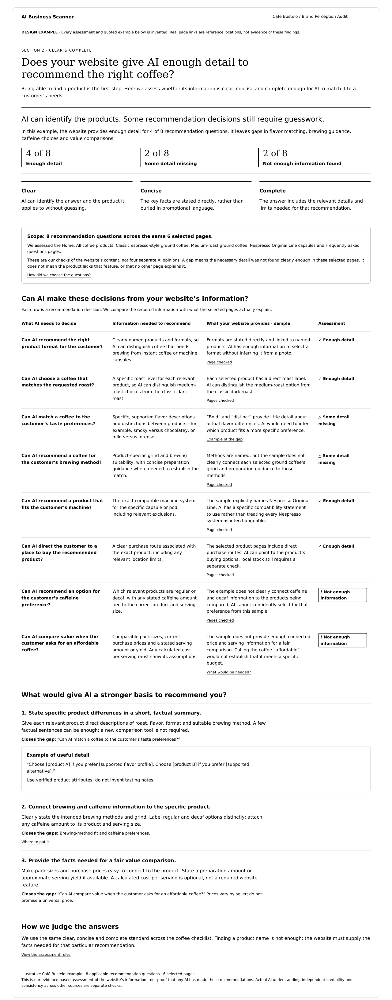

# Section 2: Clear, concise & complete

Approved reference: 23 October 2026. Product: **AI Brand Perception Audit**. Stable section ID: `clear-concise-complete`; displayed section label: **Clear & complete**.

## Approved visual

- [Standalone webpage reference](clear-concise-complete.html)
- [Structured illustrative data](sample-data.json)
- [Data contract and assessment rules](data-contract.md)
- [Technical implementation process](../../../../engineering/clear-concise-complete.md)

## What this section answers

**Does your website give AI enough detail to recommend the right coffee?** Finding a product name alone is insufficient. Assess whether the website gives clear, concise, complete information for relevant customer decisions. This is our content baseline, not proof that any particular AI understood the information or recommended the business.

Clear means the answer and product are identifiable without guessing. Concise means facts are stated directly, not buried in promotion; there is no arbitrary word-count requirement. Complete means the relevant details and limitations needed for the decision are present.

## Fixed report structure

1. Plain-language question and verdict.
2. Counts of recommendation questions by assessment, using one explicit denominator.
3. The three standards: clear, concise, complete.
4. Scope: named, linked selected pages and the checklist selection explanation.
5. Decision table: question; information needed; what the website provides; assessment. Expand rows for exact evidence, URLs and dates in real reports.
6. Ranked content improvements tied to the identified questions.
7. Expandable assessment rules and scope limitations.

Use a white background, all-black text, text labels and symbols for statuses. Technical details belong in expandable controls. Webpage first; PDF adaptation later.

## Sample and boundaries

The approved Café Bustelo visual contains **8 applicable questions across 6 selected pages**: format, roast, flavor, brewing method, machine compatibility, purchase route, caffeine and value. Counts are **4 enough detail / 2 some detail missing / 2 not enough information**. Six is the selected-page count, not the total website size. Eight counts questions, not pages, products or AI models.

All findings and example quotations are invented. Real URLs identify reference locations only. The fixture intentionally has no evidence excerpts, timestamps, snapshots or production criterion scores. Keep the design-example banner until replaced with validated evidence. No live scan has been performed for this fixture.

Use industry standards, then apply questions only to relevant products and decisions. Coffee is the sample, not a universal checklist. Certifications, ingredients and dietary requirements are added when relevant; they are not automatically mandatory for every product. Owners provide optional facts, not desired positioning.

A gap means insufficient detail in selected readable sources. It does not prove a product lacks a feature or the answer is absent everywhere. Unavailable sources produce **Could not assess**, not a missing-content finding. **Not applicable** is separate. A short factual answer can suffice; neither a dedicated FAQ page nor a comparison tool is mandatory.

Discovery/accessibility remains Section 1. Independent credibility, product quality, cross-web consistency and actual model recommendations are separate checks. This approval covers this section's visual and behavior; the linked engineering document is the proposed implementation plan, not deployed functionality.

## Handoff acceptance

Keep the approved structure and language; make content evidence-driven. Expose exact pages and product scope. Reproduce fixture counts without inventing evidence. Preserve distinctions between unavailable, absent, ambiguous and inapplicable information. Every real finding and suggested improvement must trace to its underlying question and source evidence.

## Subsequent standard update — 23 October 2026
The [shared decision-fact standards](../../decision-fact-standards.md) now govern future completeness and consistency reports, with 5–10 total facts across Core and When relevant. The earlier eight-question coffee visual above remains an approved synthetic design reference, but its purchase-route checklist is superseded for future report generation. Do not silently reuse or convert its 4/2/2 findings under the new standard.

