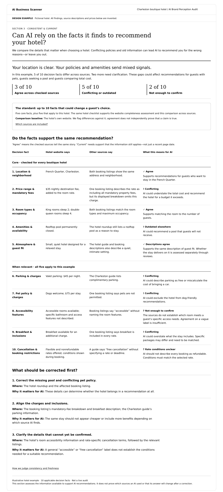

# Section 3: Consistent & current

Approved reference: 23 October 2026. Product: **AI Brand Perception Audit**. Stable ID: `consistent-current`.

- [Standalone webpage](consistent-current.html)
- [Illustrative structured data](sample-data.json)
- [Data contract](data-contract.md)
- [Technical implementation process](../../../../engineering/consistent-current.md)
- [Shared decision-fact standards](../../decision-fact-standards.md)

## Purpose

**Can AI rely on the facts it finds to recommend your hotel?** Compare decision-relevant facts across selected sources, against the business website as the comparison baseline. Explain how conflicts, stale information and unresolved detail could affect an AI recommendation. This is a source assessment, not proof of what an AI actually read, understood or recommended.

Consistency asks whether comparable facts agree. Currency asks whether the facts still apply. Agreement does not establish freshness or truth; a recent retrieval/publication date alone does not establish currency. Credibility and independent corroboration are separate report work.

## Approved structure

1. Plain-language question and verdict.
2. Counts: agree / conflicting or outdated / not enough to confirm, with one applicable-fact denominator.
3. Scope and standard, website comparison baseline, expandable source inventory.
4. Table grouped into **Core** and **When relevant**: decision fact; website statement; other-source statements; implications for AI.
5. Prioritized fixes naming the source to correct and recommendation risk.
6. Expandable methods and limitations.

White background, all-black text, plain English, webpage first. Real evidence expands to source names, linked URLs, exact wording and dates; never fabricate this information.

## Approved hotel example

Fictional Charleston boutique hotel. Ten applicable facts: five core (location; price/fees; rooms/occupancy; amenities; atmosphere/guest fit) and five conditional (parking; pets; accessibility; breakfast; booking restrictions). Counts: **3 agree, 5 conflicting or outdated, 2 not enough to confirm**. All findings, prices and source descriptions are invented. No real hotel or provider was tested.

Keep the approved design intact. Generic source names and null URLs/timestamps are deliberate fixture placeholders, not valid production evidence. The five illustrative source categories include the website, two booking listings and two editorial pages; this is not a crawl count. Do not interpret an unspecified source's silence as corroboration.

## Shared report decision

Use 5–10 decision facts total for each business type, never more than ten; the cap includes both buckets. Only **Core** and **When relevant** appear in the standard. Do not add buying-context or unnecessary-fact buckets. Apply one versioned standard to both Section 2 website completeness and Section 3 cross-source consistency. Hotel is this section's sample; coffee standards are recorded separately in the shared standard.

Exclude inapplicable facts with a reason. Unreadable sources remain unavailable, not missing or contradictory. Compare the same property, room, package, rate and effective period. Fees or policies that differ for legitimate packages are not automatically conflicts. Rates for specific travel dates still need a fresh quote; no additional buying-context bucket is introduced.

## Acceptance and handoff

Preserve the 10-row fixture and 3/5/2 counts. Separate agreement from currency in production records, even when a concise display label combines them. Show source limitations and unresolved facts. The website is the reference baseline, not infallible truth; flag its own omissions and contradictions. Keep physical service quality and review-backed guest fit for credibility assessment. The engineering process is a proposed specification; no production scanner is delivered by this documentation update.
