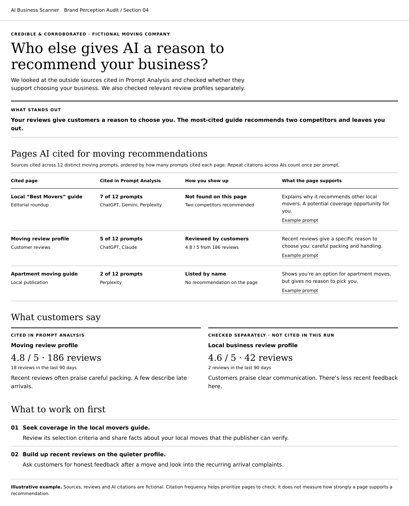

# Section 4: Credible & corroborated

**Who else gives AI a reason to recommend your business?**

This section assesses the outside support a business has across the web: customer reviews, relevant editorial recommendations and other independent coverage. Find & Read and Clear & Complete focus on the business website; Consistent & Current checks agreement on business facts. This section asks where other sources give customers a reason to choose the business.

- [Webpage](model-comparison.html)
- [Illustrative moving company data](model-comparison-sample.json)
- [Data contract](data-contract.md)
- [Implementation notes](../../../../engineering/credible-corroborated.md)

## What the owner sees

1. **What stands out:** strongest existing support and the most useful coverage gap.
2. **Pages cited in AI Prompt Analysis:** the exact page, how many distinct relevant prompts cited it, which AIs cited it, whether the business appears, what the page supports and any competitors the page recommends.
3. **What customers say:** ratings, review counts, recent activity and specific positive or negative themes. A small set of relevant profiles can be checked independently and must be labeled **Checked separately**.
4. **What to work on first:** two or three evidence-backed actions.

Citation frequency prioritizes pages to inspect. A recommendation with a specific reason, a plain listing, and a page that recommends competitors without naming the business are different outcomes. Absence is scoped to a page we checked, not the entire publisher. A citation does not establish influence or endorsement.

## Example and scope

The fictional moving company example shows three cited pages across twelve distinct moving prompts and one additional review profile checked separately. All pages, reviews, citations and provider observations are illustrative. No live scan was performed.

This design replaces the earlier hotel example and the model-by-model claim-accuracy layout. Use the existing Prompt Analysis findings as the starting point; do not add a new named-business question set by default. Show provider names with observed citations rather than four answer-alignment scores. The broader instructions for using Prompt Analysis findings throughout the Brand Audit are still a [build-plan to-do](../../../../planning/build-plan.md#to-do--brand-audit-inputs-from-ai-prompt-analysis).
