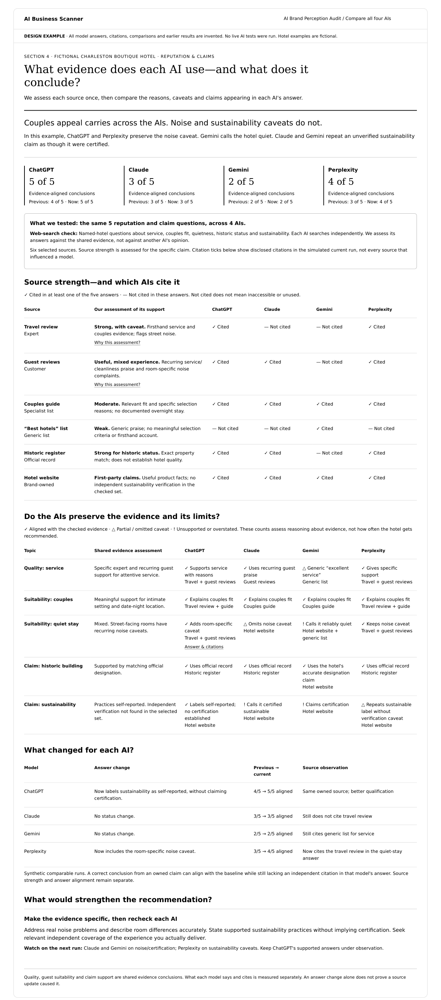

# Section 4: Credible & corroborated

Revised design proposal, 24 October 2026, implementing the confirmed all-four-model requirement. Product: AI Brand Perception Audit. The section's original visual was discussed but not separately logged as an approved section before this revision.

- [Webpage](model-comparison.html)
- [Synthetic current and previous data](model-comparison-sample.json)
- [Shared model comparison standard](../../multi-model-report-standard.md)
- [Data contract](data-contract.md)
- [Implementation](../../../../engineering/credible-corroborated.md)

## Purpose and structure

Assess meaningful support for quality, guest suitability and significant claims, then show what ChatGPT, Claude, Gemini and Perplexity say and cite. Source strength is assessed once for relevance, specificity, independence/disclosures and evidence. Positive sentiment, famous publishers or repeated generic mentions do not automatically make support strong.

Show a model-specific verdict; four side-by-side outcome summaries; mode/scope; source-strength table with all four citation columns; topic/evidence baseline and four answer columns; per-model history; source and representation improvements. All-black text on white, plain-language labels, expandable exact answers/evidence and explicit denominators.

## Synthetic hotel example

Same fictional Charleston hotel. Six source references: travel review, guest reviews, couples guide, generic list, historic register and hotel website. Five topics: service, couples fit, quietness, historic status and sustainability. Simulated evidence-aligned answer counts: ChatGPT 5/5, Claude 3/5, Gemini 2/5, Perplexity 4/5. Simulated earlier counts 4/5, 3/5, 2/5, 3/5. Every answer, citation and change is invented; no real reviews, sources or models were tested.

Source strength and observed model citation are different. The source matrix shows binary cited-at-least-once within the declared questions, not all model influences or causal source weight. Guest review findings need real sample/window/theme counts in production. Historic records support designation only; self-reported practices are not a certification. Claims lacking support in selected sources remain unconfirmed, not automatically false.

The reference is a revised proposal implementing the user's model-comparison correction, not an assertion of live findings or independent approval of every invented example. Future evidence can change the baseline through an explicit versioned reassessment.
