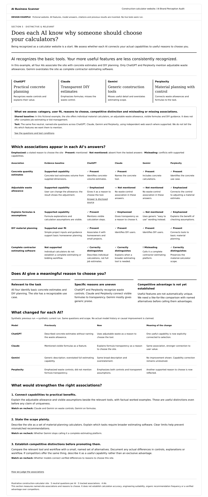

# Section 5: Distinctive & relevant

Direction agreed and visual/reference created 24 October 2026. Product: **AI Brand Perception Audit**. Example business: a fictional construction-calculator website. The user approved the conceptual exercise and requested this visual and documentation; the newly drawn visual has not separately been reviewed.

- [Standalone webpage](distinctive-relevant.html)
- [Structured synthetic current/previous data](sample-data.json)
- [Data contract](data-contract.md)
- [Technical process](../../../../engineering/distinctive-relevant.md)
- [Shared four-model report requirement](../../multi-model-report-standard.md)

## Purpose

**Does each AI know why someone should choose your calculators?** Assess whether actual capabilities connect to relevant user needs and specific reasons to choose the business in each model's answers. Recognition of a generic category alone is insufficient. Distinguish useful capabilities from verified competitive advantages.

The prior section asks whether evidence supports quality, suitability and claims. This section asks whether each AI expresses those supported attributes as meaningful associations and reasons to choose. Source credibility, calculation accuracy, autonomous discovery and actual recommendation frequency remain separate assessments.

## Five assessment dimensions

1. Category association: recognizes specific tools rather than a generic calculator site.
2. User fit: identifies supported audiences and needs without inventing professional suitability.
3. Reasons to choose: connects real features to practical benefits.
4. Competitive distinction: expresses meaningful, supported differences against comparable named alternatives.
5. Missing/misleading associations: overlooks supported relevant capabilities or overstates scope.

These are five evaluation dimensions, not a new mandatory construction-calculator decision-fact standard. The shared 5–10 decision-fact limit for completeness/consistency remains unchanged. Select relevant tracked associations without forcing desired positioning from owner onboarding.

## Fixed layout

Plain-language question/verdict; four model-specific descriptions; scope/test method; association matrix with shared evidence and four AI columns; conclusions on relevance/specificity/competitive distinction; per-model previous/current history; ranked improvements tied to associations and models; expandable rules/evidence.

Use white background, all-black text, status labels and expandable details, consistent with the earlier sections. Keep all four AIs visible side by side. Real reports show exact answers, prompts, model/date metadata and disclosed sources.

## Example semantics

Five neutral named-site questions per AI; one answer per question; five tracked associations. Independent web-search mode where supported, with no baseline answer key or desired feature list supplied to models. Named-site diagnosis does not establish spontaneous inclusion in unbranded buyer recommendations.

Tracked associations: concrete quantity estimates; adjustable waste allowance; visible formulas/assumptions; DIY planning; full contractor estimating software. The first four are supported in the invented baseline; the last is not. Gemini's overstatement is misleading, not a missing strength. ChatGPT/Perplexity emphasize waste controls; Claude/Perplexity emphasize formula transparency. Five association rows are not five independent samples of the same prompt or a recommendation count.

“Present” means explicit mention in the tested answers. “Emphasized” requires an explicit reason to choose or connection to user value; it is not a statistical frequency estimate. “Not mentioned” is scoped to the recorded questions. Unavailable is never silently converted to not mentioned. Correct recognition of a limitation is useful.

Competitor advantage is **not established**: this example contains no named comparison set. Do not imply adjustable waste or visible formulas are unique. If comparisons later support a distinction, show the named tools, equivalent use case, tested feature and limits before claiming an advantage.

All capabilities, source references, model answers, history and changes are invented. No real calculator site, calculation, competitor or AI was tested. Keep the design-example banner; fixture omissions prevent production evidence validation.

## Handoff acceptance

Preserve four providers, five tracked rows and the declared question set. Trace every real association to exact answer spans and evidence; preserve negation and scope. Track newly recognized features, stronger reasons to choose, lost associations and corrected mischaracterizations by model with comparable history. Content changes, source corrections and model representation changes have separate evidence. This update documents a reference/specification, not a working scan service.
