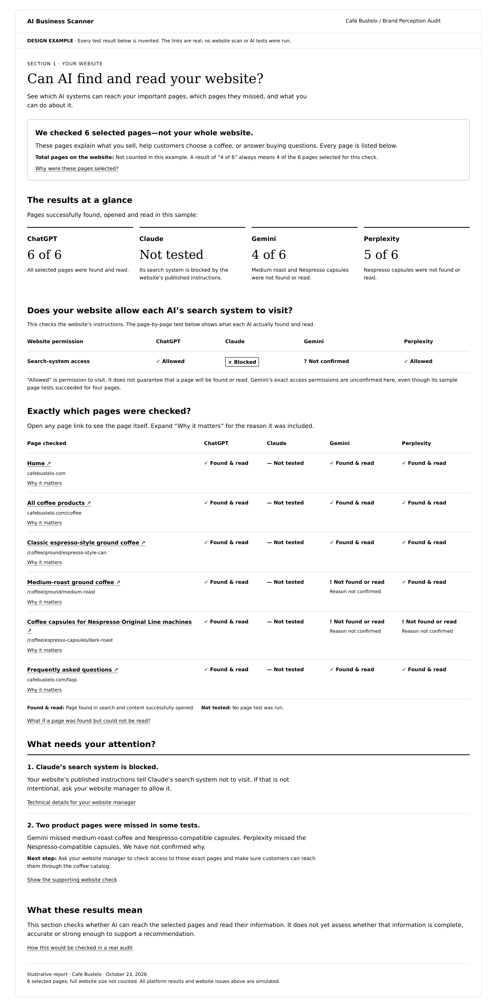

# Section 1: Website discovery and accessibility

**Report:** AI Brand Perception Audit / Analysis / Report (formerly Brand Strength Analysis).
**Section ID:** `website-discovery-accessibility`
**Design approved:** 23 October 2026.
**Status:** Approved reference design and sample data; no production scan implemented.

## Start here

- [Approved visual](website-discovery-accessibility.png)
- [Webpage reference](website-discovery-accessibility.html) — download/open in a browser; the image captures its default state.
- [Structured sample data](sample-data.json)
- [Data contract](data-contract.md)

## Purpose

Help a business owner with no web background understand whether each AI can discover and access the business's own website. Report the findings plainly so the owner can decide what to change. A confirmed access restriction belongs in the report without requiring proof of lost recommendations.

This section does not grade product quality, reviews, claims, third-party coverage or recommendation frequency. Those belong to later sections. This package locks this first section only; it does not finalize the rest of the report.

## Approved presentation

1. **Heading:** “Can AI find and read your website?”
2. **Scope:** “We checked 6 selected pages—not your whole website.” Explain the selection and whether the full site size is known. Six is sample data, not a product limit.
3. **Results at a glance:** One result per ChatGPT, Claude, Gemini and Perplexity. Use the same selected-page denominator. Show Not tested when no test was run.
4. **Website permission table:** Whether the published rules allow each relevant AI search system to visit. Allowed / Blocked / Not confirmed. Keep this separate from page tests.
5. **Exactly which pages were checked:** Every selected page's full, understandable name, clickable URL and expandable “Why it matters,” alongside each platform's result.
6. **What needs your attention:** State what happened, name the affected pages/platforms, and provide an owner option in plain English.
7. **What these results mean:** Concise scope explanation; expandable testing and evidence details.

### Visual requirements

- Design as a responsive webpage first. PDF layout is later work.
- White background; all text black, including notes, links, status labels and secondary text. No green palette or low-contrast gray text.
- Use readable text, spacing, headings and table structure rather than unexplained scores.
- Text and symbols communicate status; never rely on color.
- Technical vocabulary goes behind “Technical details for your website manager.”
- Use native expandable details, descriptive external links and responsive tables.
- Keep page names visible; do not use unexplained labels such as “capsule page.”

## Page selection

Identify the pages that support customer decisions: homepage, product/service catalog, relevant individual offerings, FAQs/policies, prices, locations/service areas and contact/booking pages where applicable. Select based on the business and buying needs; do not assume one industry template covers every site.

Show the selected list and reasons before testing in the production setup; allow the owner to add relevant pages. In the result, disclose selected-page count, total site page count if known, and collection limits. A total of null means unknown, not six.

Record a relevant page not found during site discovery separately from a selected URL that an AI did not find. Do not invent a URL or silently drop a missing page. A site-discovery limit prevents claiming the page does not exist anywhere.

## Plain-English results

| Underlying result | Owner-facing wording |
| --- | --- |
| Search surfaced URL and expected content was returned | Found & read |
| URL surfaced but content could not be read | Found, but could not read |
| Search did not surface URL; direct-link reading succeeded | Read using direct link; not found in search |
| URL did not surface and retrieval did not succeed | Not found or read; reason not confirmed |
| No platform test performed | Not tested |
| Evidence insufficient to assess | Not confirmed |

Keep search and reading results separate in the data, even when the UI combines them. An answer can mention a product without using the selected website page; that does not count as successful page access.

## Evidence and correctness rules

- Allowed by published rules is not a verified crawler visit, successful retrieval or indexing.
- A failed retrieval or absent search result is not proof of an explicit block.
- A blocked search crawler does not prove user-requested page access is blocked. Not tested stays Not tested.
- Search crawling, user-directed access and training are separate purposes. This section is not a training opt-in assessment.
- Identify the exact platform/tool, route, test wording, URL and timestamp for actual runs. API behavior is not guaranteed to match the consumer app.
- Googlebot rules concern Google Search; do not equate them with every Gemini tool. No Google AI Overview collection is introduced into MVP.
- Do not verify real crawler access by changing only a request's user-agent string. Verified visits need appropriately verified logs or provider evidence.
- If owner logs or webmaster tools are unavailable, indexing/visit claims can remain unconfirmed. Do not require an unapproved integration to render the section.
- Preserve actual evidence and dates; do not turn an owner completion checkbox into verified access.

## Sample invariants

All data here is fictional test data for a real brand. No live technical audit or provider tests were performed. The selected URLs are real reference URLs; the results do not establish current restrictions or defects at Café Bustelo.

| Platform | Selected pages | Found and read | Published search permission |
| --- | --- | --- | --- |
| ChatGPT | 6 | 6 | Allowed, simulated |
| Claude | 6 | Not tested | Blocked, simulated |
| Gemini | 6 | 4 | Not confirmed |
| Perplexity | 6 | 5 | Allowed, simulated |

Gemini misses medium roast and Nespresso Original Line capsules in the example; Perplexity misses the capsules. These are not actual findings. The site's full page count is unknown. Never display 4/4 for Gemini after discarding two unsuccessful pages.

## Acceptance checks for implementation

- Every selected URL has an explicit result per platform, including Not tested and Not confirmed.
- Summary counts are computed from the same page records displayed in the table.
- Number of selected pages is always distinguished from total website pages.
- Affected pages are named and linked in findings.
- Permission, search discovery, reading and indexing are not conflated.
- Unsuccessful results preserve unknown causes rather than inventing blocks.
- The default UI is understandable without reading technical details.
- Mobile layouts preserve all pages, platform labels and evidence access.
- All simulated content stays visibly labeled in screenshots and exported copies.

## Design handoff to Claude

Implement this section using the approved webpage reference and sample data. Preserve the page inventory, simple language, white background, black text, consistent counts and separate access-permission check. Keep the rest of the report out of this iteration. Treat the HTML as a reference design, not a production scanner. Build the production UI from the data contract and never present the sample as a real scan.

## Technical implementation
See the [end-to-end implementation process](../../../../engineering/website-discovery-accessibility.md). It details collection, page selection, permissions, provider capability validation, independent search/reading tests, evidence requirements, cache behavior, job records and acceptance cases. Published crawler blocking does not automatically cancel a separate permitted URL test; the Claude sample is illustrative, not that execution rule.

