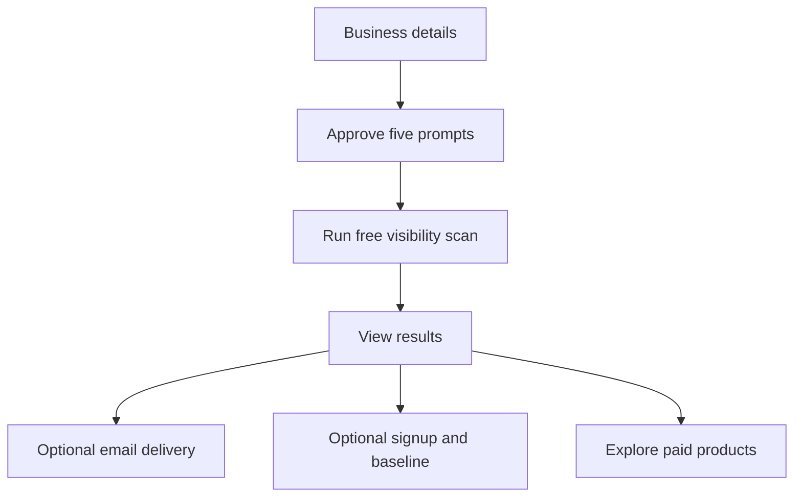
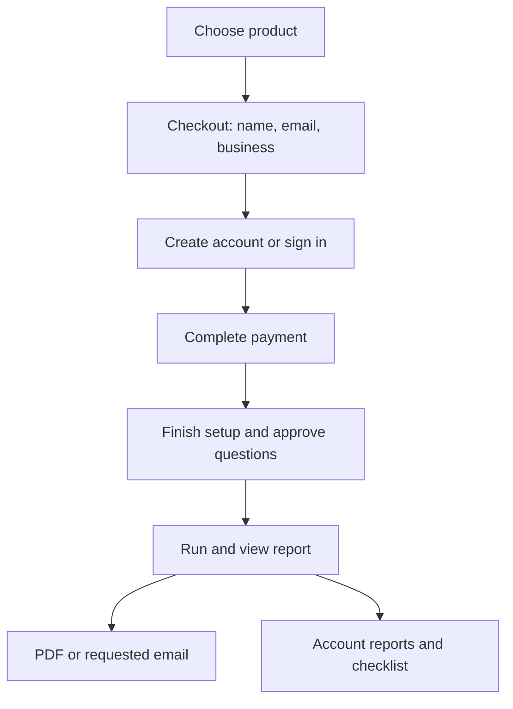

# Website and customer journey map
Version 0.3 • 22 October 2026

Start visual work with the [Claude Design skeleton brief](claude-design-skeleton.md). Proposed grouping/routes below implement current product decisions; prices/caps/plan terms remain open.

## Public navigation
Header: logo/Home; **Products**; Pricing; Sign up; Log in; Free visibility check.
Products: AI Prompt Analysis, Brand Strength Analysis, Competitive Analysis, Location Analysis, Monitoring Dashboard.
Each has its own substantive public page; visitors may land directly from search. Footer links methodology, samples/learning, privacy, terms and help.

Homepage sequence: promise → what AI understands → who it recommends → competitive reasons → geographic gaps → monitor progress → choose a product/free check.
See [website requirements](website-structure-and-seo.md) for route/indexing details.

## Guest free journey

No upfront email/account and no free Brand Strength. Optional email/signup never blocks results.

## Paid journey

Checkout/account steps can form one short screen. Final question selection follows payment within purchased caps. Returning users reuse profiles/prompts.
Interrupted paid setup resumes from account Reports. No guest paid orders. Free and paid flows share components, not identical entry/payment rules.

## Signup and workspace
Baseline: imported facts for approval/correction → relevant locations/competitors → priorities/goals → prompt suggestions/order.
Account workspace contains Reports, Prompts, Brand & Competitors, Locations, To-do list, Business profile and Billing. Subscription gates monitoring, not purchased-report access.
Prompt checks three times weekly. Full brand/competitive/location cadence monthly versus twice monthly is open; show independent last/next refresh dates. Dashboard release timing remains open, but include it in the design skeleton.

## Templates
Public: homepage, products overview, four report details, dashboard detail, pricing, methodology, labeled samples/learning.
Transaction: free setup, checkout/auth, onboarding, question/setup approval, progress, email verification.
Private: four result templates, account workspace, checklist/evidence history, billing and unavailable/access states.
Details and status rules live in [flows](user-flows-and-rules.md), [catalog](report-catalog.md) and [brand/checklist spec](brand-evidence-and-checklist.md).

## Decisions not made by this map
Exact authentication method, prices, paid caps/repetitions, free abuse allowance, monthly/twice-monthly full cadence, exact schedule times, subscription/bundle terms/release timing and retention. Do not invent them in mockups.
