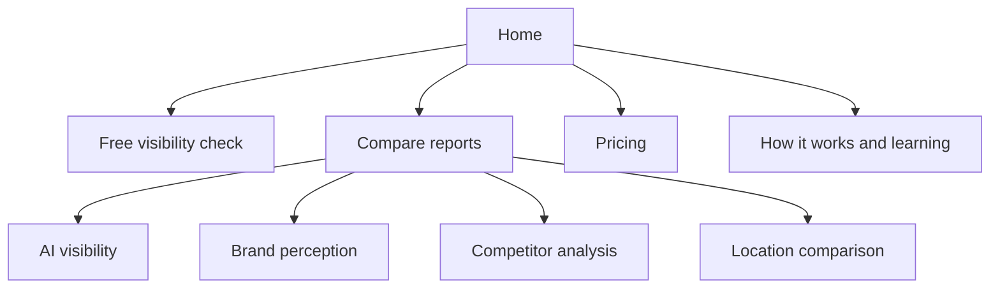
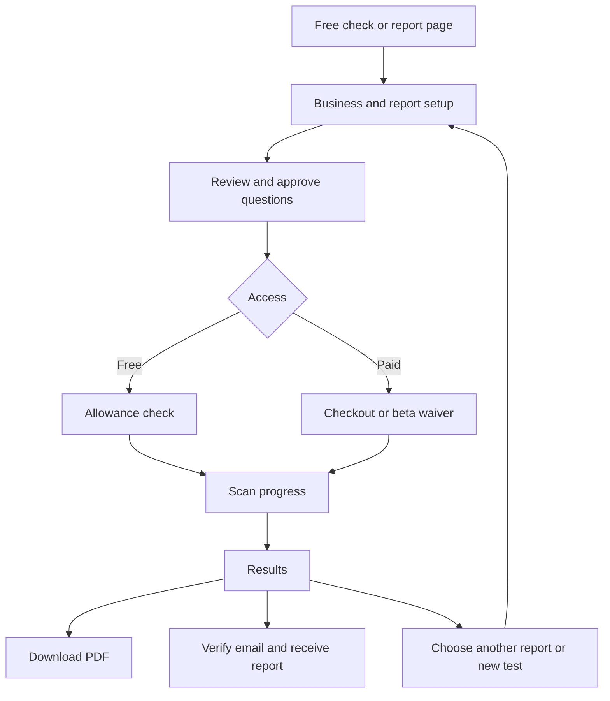

# Launch website and customer journey map
22 October 2026 • Proposed design map aligned with confirmed scope

Use this map for the first Claude Design pass. Page grouping, navigation labels and screen layout are proposed; they do not settle open prices, limits or subscription decisions.
Source contracts: [report catalog](report-catalog.md), [flows and rules](user-flows-and-rules.md), [website/SEO requirements](website-structure-and-seo.md).

## 1. Public site

Proposed header: logo/Home, Reports dropdown, Pricing, How it works, prominent Free check action. How it works can be a homepage section linking to the methodology page rather than an extra page.
Footer: methodology, learning resources, samples, privacy, terms and contact/help. Legal/contact destinations are proposed supporting pages; exact policy text still needs preparation.

This is an information hierarchy, not a restriction on entry. Search visitors can land directly on any report page and start that report. Each product page links to its sample and related reports.

| Public page | What the visitor should understand | Main action |
| --- | --- | --- |
| Home | Customers ask AI about needs; our product tests where the business appears and how it is described | Run free check; secondary Browse reports |
| Compare reports | Which of four reports answers their question | Choose report |
| AI visibility | Mentions, recommendations, competitors and citations | Start visibility report |
| Brand perception | Descriptions, suitability feedback, discovery ideas and improvements | Start brand report |
| Competitor analysis | Which tested questions recommend each competitor and where gaps appear | Start competitor report |
| Location comparison | How results differ across explicit markets | Start location comparison |
| Pricing | Independent purchases, exact scope and free limits once decided | Choose report |
| Methodology | What is measured, which four APIs, evidence and limitations | Explore reports |
| Sample results | Inspect a labeled illustration of the output before buying | Start corresponding report |
| Learn | Plain-English explanations and customer-situation examples | Relevant report or free check |

No indexed customer reports. Agency packs, accounts/dashboard navigation and subscription checkout are outside this launch map pending later scope.

## 2. Shared customer journey

The free journey skips payment. A declined payment stays at checkout; an exhausted free allowance explains the next available action. No account is required for individual purchases.
Show the selected report and compact business summary throughout setup. Reuse confirmed inputs when starting another report, allow corrections, and require new approval and payment/allowance checks.

## 3. Screens to design

| ID | Screen/template | Key content and action |
| --- | --- | --- |
| S1 | Business setup | Name, website, language and relevant market; show inferred facts for correction; manual entry if fetch fails |
| S2 | Comparison details | Competitors where applicable; two or more places for location comparison; can be a section within S1 |
| S3 | Question review | Suggested questions, edit/select controls, report scope and language; approve final list |
| S4 | Checkout | Exact product, scope, price, retention and failure policy; pay or redeem beta waiver |
| S5 | Scan progress | Four provider states and successful/expected work; recovery explanation and real partial/failure messages |
| S6 | Report results | Shared report shell with report-specific sections and inspectable evidence |
| S7 | Email delivery | Enter address, verification pending, verified/queued and delivery failure states; modal/panel is sufficient |
| S8 | Unavailable report | Expired/deleted/invalid-link state with appropriate next action and no leaked evidence |

PDF is a download, not another full webpage. Original answers/citations open in a drawer or expandable section rather than requiring a separate screen per answer.
Use a final approved-scope summary on S3/S4; do not create an extra confirmation screen without a clear need.

## 4. Report-specific setup

| Report | Setup variation | Question review |
| --- | --- | --- |
| Visibility/free sample | Business, optional market and supported optional competitors | Neutral customer questions; free scope shown explicitly |
| Brand | Business identity and optional comparison brands | Clearly labeled named-brand questions; any separately included discovery tests labeled |
| Competitor | Business, selected competitors, market | Neutral customer questions; names are used for matching afterward |
| Location | Business, at least two places and optional selected competitors | Common question family and each location's wording |

Competitor-only analysis without a target business remains proposed; do not build it as confirmed scope.
Do not let a single “add competitors” control silently turn the visibility purchase into the deeper competitor report.

## 5. Shared results shell

Top: report name, business, date, language, locations and provider coverage.
Then: executive summary, report-specific overview, question/provider evidence, citations, opportunities/actions where included, and methodology/access details.
Persistent actions: Download PDF and Email my report. Another report is a secondary next step.
Partial data is visible at both summary and individual cell/provider level; missing answers are not non-mentions.

| Report | Primary sections |
| --- | --- |
| Visibility | Mentions/recommendations; question × provider table; competitor gaps; top cited sources; action/opportunity checklist |
| Brand | What AI says; stated strengths/concerns; suitable/unsuitable situations; separate tested discovery findings if included; creative opportunities; suggested improvements |
| Competitor | Question × business comparison with provider detail; prompts recommending/not recommending each competitor; gaps; citation comparisons |
| Location | Side-by-side location counts; matched question comparisons; competitors/citations by market; explicit location settings |

Brand labels must distinguish **named-brand feedback**, **tested findings**, **creative opportunities** and **suggested improvements**. An AI statement about suitability is not an observed unbranded recommendation.
A generated suggestion can be selected as a future test. It returns to approval and disclosed allowance/purchase steps rather than starting a charge or scan automatically.

## 6. States that need visual treatment

| Area | States |
| --- | --- |
| Website/profile | Fetching, extracted/editable, blocked/unreadable with manual fallback, invalid input |
| Question review | Generating, ready, empty selection, invalid/branded discovery question, generation failure |
| Payment/access | Ready, processing, declined/canceled, waived, allowance exhausted, capacity unavailable |
| Scan | Queued, running, partial, completed, all failed |
| Results | Recommended, mentioned only, absent, ambiguous, no business recommendation returned, missing provider answer |
| Export/email | Preparing PDF, download failure/retry, verification pending/expired, queued, accepted/delivered where known, failed |
| Report access | Valid, expired, deleted, invalid/revoked link |

Use realistic mock evidence to design long answers, long URLs, Spanish text, small mobile tables and zero recommendations. Label examples visibly; do not present fixture counts as live results.

## 7. Design order

1. Rough frames for the public map and complete shared flow, including all four report variations.
2. Polish one paid visibility journey: product page, setup, questions, checkout, progress and results.
3. Apply its forms/tables/evidence components to the other three reports and free journey.
4. Complete public content, mobile layouts, accessibility and failure states.

Validate the live four-provider prototype alongside visual design. All four reports remain required at launch even though one journey is polished first.

## Open decisions
Prices; free and paid question counts; repetitions; competitor/location caps; retention; final brand/domain; subscription/dashboard design and timing; agency pack design.
Use labeled placeholders in mockups. No guessed subscription plans, ratings, search volumes, AI-readiness scores or guaranteed improvement claims.
